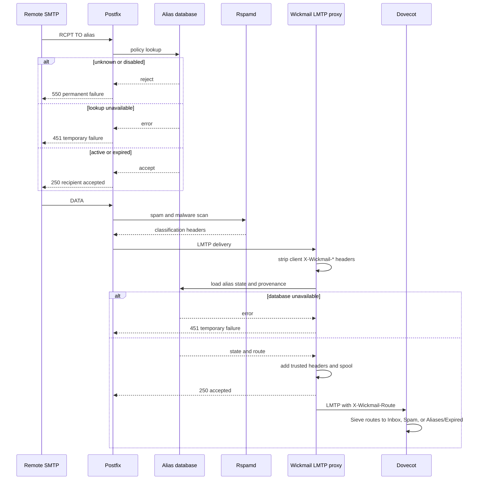

# Wickmail mail server design

## Purpose

Provide conventional email hosting with programmable, expiring aliases. An alias controls delivery to the primary mailbox without exposing the mailbox's real address, and replies sent from the management app preserve the alias identity.

The server must:

- Generate readable random alias addresses with separately stored expiration settings.
- Validate recipients before SMTP acceptance and route mail at delivery.
- Deliver mail from active aliases normally.
- Quarantine mail sent to expired aliases.
- Renew aliases based on authenticated user activity.
- Prevent inbound mail from extending its own delivery window.
- Support replying through an alias without revealing the primary address.
- Expose alias, quarantine, and reply operations through an authenticated API.
- Never permanently reject mail for alias policy after SMTP acceptance.

## Non-goals for v1

- Implementing SMTP or IMAP protocols from scratch.
- Providing general webmail. The app includes a focused reply composer only.
- Supporting alias identity selection in arbitrary email clients.
- Letting users choose or edit an alias local part.
- Executing arbitrary user-supplied code in the mail-delivery path.
- Automatically inferring purchases or support conversations from message contents.
- Supporting multiple organizations or delegated alias ownership.

## Architecture

Use established mail components with a custom policy service and LMTP proxy.

```text
                         ┌──────────────────────────┐
Internet ── SMTP ──────► │ Postfix                  │
                         │  - RCPT policy lookup    │
                         │  - Authenticated submit  │
                         └────────────┬─────────────┘
                                      │
                                      ▼
                         ┌──────────────────────────┐
                         │ Rspamd                   │
                         │  - Spam and malware      │
                         │  - DKIM signing          │
                         └────────────┬─────────────┘
                                      │ LMTP
                                      ▼
                         ┌──────────────────────────┐
                         │ Wickmail LMTP proxy      │
                         │  - Strip client headers  │
                         │  - Delivery-time policy  │
                         │  - Durable spool         │
                         │  - Trusted headers       │
                         └────────────┬─────────────┘
                                      │ LMTP
                                      ▼
                         ┌──────────────────────────┐
                         │ Dovecot LMTP/IMAP        │
                         │  - Sieve routing         │
                         │  - Inbox                 │
                         │  - Spam                  │
                         │  - Aliases/Expired       │
                         └──────────────────────────┘

Web/Android app ── HTTPS ──► Management API ──► Alias database
                                      │
                                      ├─► Internal mail-store adapter
                                      └─► Outbound reply submission
```

The management API, policy lookup, and LMTP proxy are one deployable application (`wickmail-server`) with logically separate interfaces. See [ADR 0006](../decisions/0006-mail-path-integration.md).

### Components

- **Postfix:** inbound SMTP, authenticated outbound submission, and RCPT-time policy lookup.
- **Rspamd or equivalent:** spam and malware classification and DKIM signing.
- **Wickmail server:** recipient policy, delivery-time routing, durable spool, management API, and internal mail-store adapter.
- **Dovecot:** IMAP, mail authentication, and local delivery with global Sieve routing.
- **SQLite:** alias definitions, policies, provenance, quarantine metadata, audit events, and API tokens. See [ADR 0010](../decisions/0010-sqlite-for-single-user-v1.md).

### Inbound mail-path contract

The inbound path has two enforcement points:

1. **RCPT policy lookup.** Postfix calls the Wickmail policy interface over a Unix socket or socketmap. Unknown and disabled recipients are rejected with a permanent SMTP failure. Active and expired recipients are accepted. An unavailable policy interface or database returns a temporary failure; it never reports an unknown recipient.
2. **Delivery-time routing.** Postfix delivers accepted mail to the Wickmail LMTP proxy. The proxy strips client-supplied `X-Wickmail-*` headers, evaluates the lease at delivery, adds trusted headers, writes the message to a durable spool, acknowledges, and then forwards to Dovecot. Dovecot's global Sieve script routes on the trusted route header.

Spam and malware classification runs before the LMTP proxy. Actual spam goes to `Spam` regardless of alias state. The proxy never permanently rejects a message for alias policy after SMTP acceptance.

### Inbound sequence



### Failure mapping

| Stage            | Condition                                | Result                                                           |
| ---------------- | ---------------------------------------- | ---------------------------------------------------------------- |
| RCPT             | Unknown recipient                        | `550` permanent failure                                          |
| RCPT             | Disabled recipient                       | `550` permanent failure                                          |
| RCPT             | Policy interface or database unavailable | `451` temporary failure                                          |
| RCPT             | Expired recipient                        | Accepted; routed at delivery                                     |
| DATA             | Malware detected                         | Rejected before final acceptance                                 |
| LMTP delivery    | Policy interface or database unavailable | `451`; Postfix retries                                           |
| LMTP delivery    | Spool unavailable or full                | `451`; alert                                                     |
| LMTP delivery    | Dovecot unavailable                      | Message stays in spool and retries; no bounce                    |
| After acceptance | Any alias state                          | Routed to inbox, quarantine, or spam; never permanently rejected |

## Address generation and canonicalization

The server generates local parts by randomly selecting common lowercase dictionary words, with two words separated by a dot by default, such as `green.farm`. Word lists avoid offensive terms, homophones, and unnecessarily long or difficult words. Selection uses a cryptographically secure random number generator, and the server enforces uniqueness and retries with a new combination or an additional word on collision.

Addresses contain no labels, merchant identifiers, timestamps, lease durations, ownership information, or other policy. Clients cannot choose a local part. The database is the sole source of truth for expiry and behavior, and changing policy never changes the address. Addresses are identifiers, not secrets; no security control depends on their being unguessable.

Alias lookup is case-insensitive. The server canonicalizes the local part to lowercase ASCII and the domain to lowercase ASCII or punycode, stores the canonical address, and enforces uniqueness on it. Plus addressing is not supported in v1; a recipient must match the canonical alias address. See [ADR 0005](../decisions/0005-generate-readable-random-aliases.md).

## Alias model

Each alias contains:

| Field                 | Description                                                           |
| --------------------- | --------------------------------------------------------------------- |
| ID                    | Stable internal UUID                                                  |
| Address               | Canonical unique full email address with a readable random local part |
| Label                 | User-facing name, such as "Example Store"                             |
| Purpose               | Optional order, merchant, or notes field                              |
| Created at            | Creation timestamp                                                    |
| Expires at            | Nullable; null means no expiry                                        |
| Disabled at           | Nullable; disabled overrides lease state                              |
| Lease duration        | Renewal duration used when a renewal does not specify one             |
| Renew on outbound     | Whether authenticated sending renews the lease                        |
| Last inbound at       | Most recent accepted inbound mail; informational only                 |
| Last user activity at | Most recent user activity; see below                                  |
| Policy version        | Optimistic concurrency control                                        |

`last_user_activity_at` updates on authenticated outbound mail, manual renew, extend, set expiry, remove expiry, recover, and enable. It does not update on label, purpose, or policy edits, on disable, or on viewing and copying an alias.

For "recently used" sorting, the last-used time is the later of `last_inbound_at` and `last_user_activity_at`. Aliases with neither timestamp use their creation time for this sort.

Aliases are never reassigned to a different owner. Reusing an alias for another purchase or interaction with the same merchant or purpose is allowed and renews the existing alias. v1 provides disable/archive rather than hard deletion.

## Lease model and evaluation

Effective state is calculated at evaluation time:

1. If disabled, the alias is **disabled**.
2. Otherwise, if `expires_at <= now`, it is **expired**.
3. Otherwise, it is **active**.

All timestamps are stored and evaluated in UTC.

### Evaluation instants

- **RCPT:** existence and disabled state are evaluated. Unknown and disabled recipients are rejected. Expired recipients are accepted.
- **Delivery:** lease state is evaluated by the LMTP proxy when the message is routed.

A message accepted while an alias was active but delivered after expiry is quarantined. A message accepted before an alias was disabled is quarantined at delivery rather than rejected. A scheduler is not required for correct enforcement; it may be added for expiration notifications.

### Outbound submission truth table

| Alias state | `renew_on_outbound` | Result                                                 |
| ----------- | ------------------- | ------------------------------------------------------ |
| Active      | true                | Accept; set `expires_at = now + lease_duration`        |
| Active      | false               | Accept; leave `expires_at` unchanged                   |
| Expired     | true                | Accept; set `expires_at = now + lease_duration`        |
| Expired     | false               | Reject submission; user must renew or enable the alias |
| Disabled    | either              | Reject submission until explicitly enabled             |

### Manual action truth table

| Action             | Requirement                            | Effect                                                                                         |
| ------------------ | -------------------------------------- | ---------------------------------------------------------------------------------------------- |
| Renew              | Enabled                                | `expires_at = now +` supplied duration, or `lease_duration` if omitted                         |
| Extend             | Enabled and non-null `expires_at`      | `expires_at = max(now, expires_at) +` supplied duration, or `lease_duration` if omitted        |
| Set expiry         | Enabled                                | Sets an absolute `expires_at`; `lease_duration` is unchanged                                   |
| Remove expiry      | Enabled                                | Sets `expires_at = null`; `lease_duration` is unchanged                                        |
| Disable            | Any state                              | Sets `disabled_at`; lease is unchanged                                                         |
| Enable             | Disabled                               | Clears `disabled_at` and sets `expires_at = now + lease_duration` unless an expiry is supplied |
| Recover            | Quarantined message                    | Moves the message to the inbox; lease is unchanged                                             |
| Recover and renew  | Quarantined message and enabled alias  | Recovers the message and applies Renew                                                         |
| Recover and enable | Quarantined message and disabled alias | Requires explicit enable confirmation, then recovers and sets a new lease                      |

### Creation

- The app requests an alias with a chosen lease or absolute expiration time.
- The server generates the readable local part; clients cannot supply an address or local part.
- A database uniqueness constraint protects against collisions, and the server regenerates on collision.
- Default lease: seven days.
- Supported presets: 24 hours, 7 days, 30 days, custom, and no expiry.
- Expiry starts at alias creation and is stored separately from the address.
- The app must create the alias before displaying it as ready to use.

### Inbound activity

Inbound messages never modify `expires_at`, including order confirmations, support responses, messages that appear to belong to an existing thread, and messages with trusted-looking `From`, `Reply-To`, or `References` headers.

### Absolute expiry and later renewals

An absolute expiry sets only `expires_at`. Later renewals use `lease_duration` unless the caller supplies a duration. An alias with no expiry ignores outbound renewal until an expiry is set; `lease_duration` is retained but unused.

### Expired as presentation state

"Expired" in lists and the activity feed is derived from `expires_at` at read time. It is not a persisted exactly-once event. A scheduler may later record a deduplicated expiration event for notifications without changing this rule.

## Inbound processing

For each incoming message:

1. Validate the recipient at RCPT against known primary addresses and aliases.
2. Reject unknown or disabled recipients, or return a temporary failure if policy is unavailable.
3. Perform malware and spam processing.
4. Deliver accepted mail to the Wickmail LMTP proxy.
5. Strip every client-supplied `X-Wickmail-*` header.
6. Evaluate the alias state at delivery and record the trusted route.
7. Add trusted headers: a stable `X-Wickmail-Message-ID`, one `X-Wickmail-Alias-ID` per receiving alias, `X-Wickmail-Route`, and `X-Wickmail-Received-At`.
8. Write the message to the durable spool and acknowledge.
9. Forward to Dovecot, where Sieve routes to `Inbox`, `Spam`, or `Aliases/Expired`.
10. Record trusted provenance and update `last_inbound_at`.

Client-supplied alias headers are never trusted. Trusted headers are inbound-only and are stripped from outbound mail.

## Quarantine consistency

The mail store is authoritative for quarantine membership; the management database holds reconciled metadata. See [ADR 0007](../decisions/0007-quarantine-source-of-truth.md).

- `X-Wickmail-Message-ID` is the stable identity. The database caches mailbox, `UIDVALIDITY`, and UID only as a locator.
- `Aliases/Expired` is isolated from the user's IMAP namespace and is reachable only through the internal mail-store adapter.
- Metadata includes the message ID, alias IDs, sender, subject, received timestamp, quarantine expiry, status, and locator cache.
- Status values are `quarantined`, `recovering`, `recovered`, `deleting`, and `deleted`.

### Recovery ordering

1. Record `recovering` with an idempotency key.
2. Copy the message to the inbox without deleting the quarantine copy.
3. Verify the inbox copy by message ID.
4. Delete the quarantine copy.
5. Mark the metadata `recovered`.

If a crash leaves a copy in both folders, reconciliation keeps the inbox copy and removes the quarantine copy. If the inbox copy is missing and the quarantine copy remains, reconciliation returns the status to `quarantined`.

### Deletion and retention ordering

1. Mark `deleting` with a reason and block recovery.
2. Delete the body from the quarantine folder.
3. Mark the metadata `deleted` and purge it after a grace period.

If the body is already gone, reconciliation marks the metadata `deleted`. Retention skips messages in `recovering` or `deleting` states. Lease quarantine retention defaults to 30 days; spam retention defaults to 14 days and is configured separately.

## Reply as an alias and outbound identity

The management app provides the controlled reply path. See [ADR 0008](../decisions/0008-alias-native-replies.md).

### Provenance

At inbound acceptance, the server records the set of envelope recipients, including blind copies, and cross-checks it against visible `To` and `Cc` for display. Envelope recipients are authoritative. Provenance is stored as alias IDs plus whether the primary address received the message.

### Reply identity selection

| Provenance              | Reply identity                                                |
| ----------------------- | ------------------------------------------------------------- |
| Exactly one alias       | That alias; the primary identity is offered as an alternative |
| No alias (primary only) | The primary identity                                          |
| Multiple aliases        | Prompt the user; never select silently                        |

If the primary address and exactly one alias received the message, the alias is the default. If multiple aliases received it, the user must choose.

### Outbound enforcement

- The envelope sender must be an owned alias selected for the reply.
- The message must contain exactly one `From` mailbox, equal to that alias.
- A present `Sender` header must equal the alias.
- `Reply-To` is omitted by default and may only be set to the sending alias in v1.
- Inbound-only headers, `X-Wickmail-*`, `Delivered-To`, `X-Envelope-To`, and any primary-address-revealing headers are stripped.
- The message is DKIM-signed with the alias domain's key and aligned for DMARC.
- A message that fails identity checks is rejected before submission is queued.

### Renewal trigger

The alias renews after the authenticated reply or outbound message is accepted and queued, not during pre-queue checks. A later bounce does not revert the renewal.

## Management API

Use JSON over HTTPS.

### Alias operations

```text
POST   /v1/aliases
GET    /v1/aliases
GET    /v1/aliases/{id}
PATCH  /v1/aliases/{id}
POST   /v1/aliases/{id}/renew
POST   /v1/aliases/{id}/extend
POST   /v1/aliases/{id}/disable
POST   /v1/aliases/{id}/enable
GET    /v1/aliases/{id}/events
```

`POST /v1/aliases` accepts labels, purposes, lease or expiration settings, and renewal policy. It does not accept a local part or full address. The response contains the server-generated address only after the alias has been stored successfully.

`GET /v1/aliases` supports:

- Filtering by state, expiration window, and presence or absence of expiry
- Searching labels, purposes, and addresses
- Sorting by expiration, last used, or creation time
- Deterministic ordering with no-expiry aliases last for ascending expiration and never-used aliases ordered by creation time for last-used sorting
- Pagination with a stable secondary sort by alias ID

### Quarantine operations

```text
GET    /v1/quarantine
GET    /v1/quarantine/{id}
POST   /v1/quarantine/{id}/recover
POST   /v1/quarantine/{id}/delete
```

`recover` accepts an option to renew or enable the alias.

### Reply operations

```text
GET    /v1/messages/{id}/reply-context
POST   /v1/messages/{id}/reply
```

`reply-context` returns the sanitized sender, subject, text, and trusted provenance needed to compose a reply. It does not turn the app into a general message browser. `reply` accepts the selected alias, body, and optional quoted text, and returns the queued result. Sending a reply renews the alias according to its policy.

### Authentication and authorization

- Browser sessions use `Secure`, `HttpOnly`, and appropriate `SameSite` cookies.
- Cookie-authenticated mutations require CSRF protection.
- Programmatic clients use revocable, scoped API tokens.
- Scopes: `aliases:read`, `aliases:write`, `quarantine:read`, `quarantine:write`, `messages:read`, and `messages:reply`.
- Every operation verifies alias ownership and message provenance.
- Mutation endpoints support idempotency or safe retry behavior.

## Authentication, bootstrap, and abuse controls

See [ADR 0009](../decisions/0009-authentication-and-bootstrap.md).

- First run uses a CLI bootstrap command with a single-use setup token; there are no default credentials.
- Management authentication and Dovecot mail authentication are separate credentials for the same user.
- Management passwords are hashed with Argon2id; passkeys are optional; sessions are server-side and revocable.
- Account recovery is local through the CLI or one-time recovery codes, not email.
- API tokens are hashed at rest, scoped, expirable, revocable, and shown once.
- Inbound limits: maximum message size, per-alias and global quarantine count and byte quotas, and per-sender and global rate limits.
- Disk-full behavior: return temporary failures and alert; never silently drop accepted mail.
- When a quarantine quota is reached, delete the oldest eligible messages first; never delete a message in `recovering` or `deleting` state.
- Audit records are retained longer than delivery metadata and never contain message bodies. Subjects and addresses in delivery metadata are purged with their retention window.

## Storage

SQLite runs with write-ahead logging, foreign keys enabled, a busy timeout, and versioned migrations. A single process owns writes; the policy lookup and LMTP proxy coordinate through that process. Maintenance tasks must not hold write transactions across mail-path operations.

## Reliability and security

- Do not operate as an open relay.
- Validate alias ownership before outbound submission.
- Rate-limit outbound mail and management authentication.
- Configure SPF, DKIM, DMARC, reverse DNS, and TLS correctly.
- Keep management authentication separate from mail authentication.
- Do not log message bodies.
- Back up the mail store, SQLite database, and configuration; test restoration and reconciliation.
- Monitor SMTP queue depth, spool depth and age, disk usage, certificate expiry, authentication failures, policy-service failures, and reconciliation results.

If alias policy cannot be evaluated, the server must not silently deliver or discard mail. It returns a temporary failure or holds the message in the spool.

## Testing

Failure-injection tests must cover:

- Policy-service or database outage at RCPT and at delivery
- Crash during recovery before the inbox copy, between copy and delete, and after delete
- Crash during retention deletion before and after body deletion
- Retention running while recovery is in flight
- Spool full and Dovecot unavailable
- Multiple-alias provenance and primary-plus-alias provenance
- Reply identity mismatch and multiple `From` rejection
- Address canonicalization and case-insensitive lookup

## Acceptance criteria

- Generated local parts are unique, readable combinations of randomly selected dictionary words and contain no user-supplied or policy-derived components.
- Changing expiration or other policy does not change an alias's address.
- Alias list filtering and sorting handle expiration, no expiry, recent use, and never-used aliases deterministically.
- Unknown and disabled recipients are rejected before acceptance; expired recipients are accepted and quarantined.
- Policy or database failure returns a temporary failure and never reports an unknown recipient.
- Mail to an active alias reaches the inbox.
- Inbound messages never extend the lease.
- Mail arriving at or after expiry is quarantined.
- An authenticated outbound message renews an active alias when `renew_on_outbound` is true.
- Sending through an expired alias reactivates it only when `renew_on_outbound` is true.
- A spoofed inbound `MAIL FROM` cannot trigger renewal.
- Client-supplied `X-Wickmail-*` headers are stripped and cannot influence routing.
- Disabled aliases neither receive nor send mail.
- Recovery and retention are idempotent and crash-safe; reconciliation repairs either store.
- Reply provenance defaults to the single receiving alias and prompts on multiple aliases.
- Outbound replies use the alias as envelope sender and sole `From`, and are DKIM-aligned.
- Recovering a quarantined message does not duplicate it.
- No accepted message is permanently rejected or bounced for alias policy.

See the [acceptance test map](mail-server-acceptance.md) for the test that verifies each criterion.
